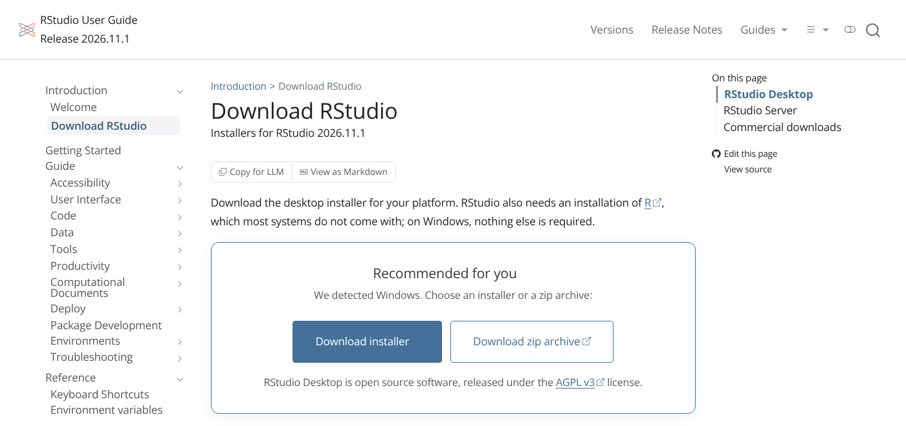
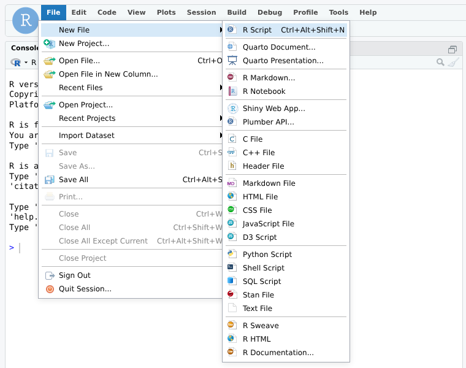
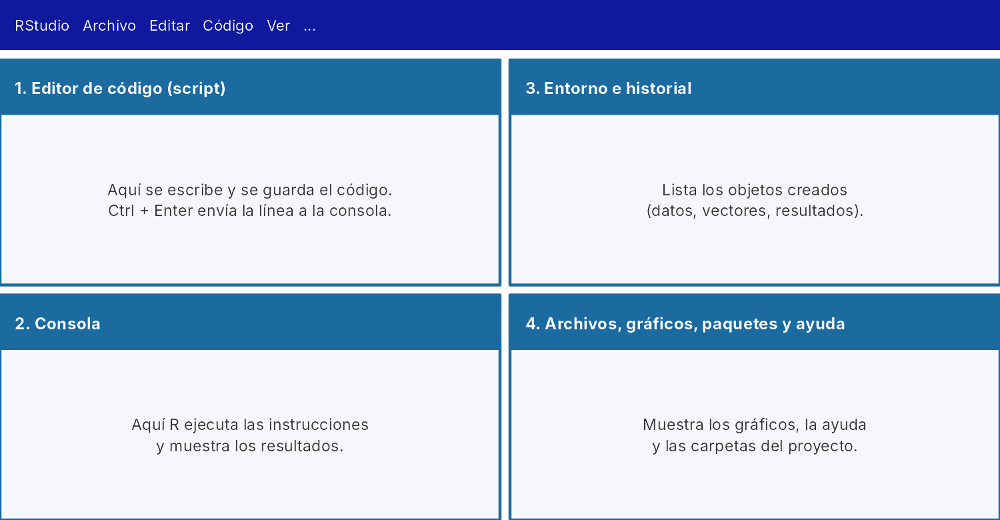
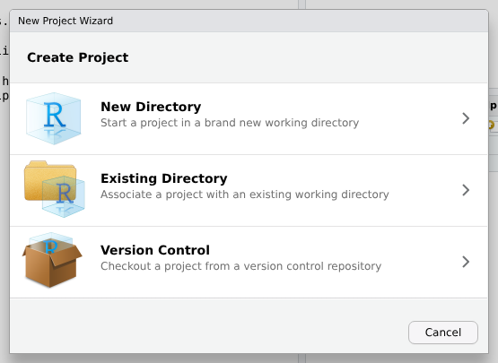
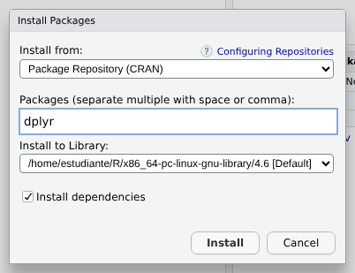
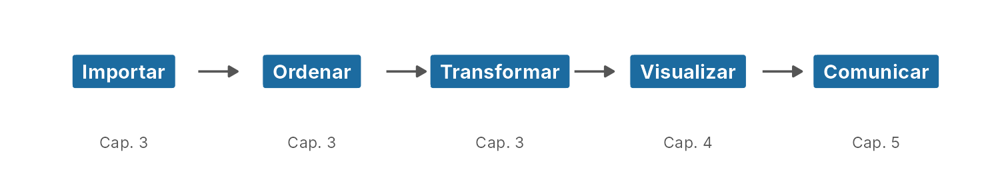

Un ingeniero civil pasa buena parte de su trabajo con números: resistencias de cilindros de concreto, conteos de vehículos, lecturas de piezómetros, asentamientos, caudales. Con una calculadora se resuelve un ejercicio; con cien datos, la calculadora se vuelve lenta y fácil de equivocar. Una hoja de cálculo ayuda, pero cuando el análisis se repite o crece, cuesta saber qué fórmula está en cuál celda. R resuelve ese problema: cada paso del análisis queda escrito, se puede revisar y se puede volver a correr con datos nuevos en segundos. Este capítulo explica cómo instalar R y RStudio, cómo está organizada la pantalla de RStudio y cómo escribir y ejecutar las primeras instrucciones.

## Qué son R y RStudio {#sec-r-que-es}

R es un lenguaje de programación y un programa gratuito para hacer cálculos estadísticos y gráficos [@rcoreteam2025r]. Funciona en Windows, macOS y Linux, y lo mantiene una comunidad internacional de estadísticos y programadores. Lo que hace a R tan útil es la cantidad de paquetes que existen para él: un paquete es un conjunto de funciones que alguien escribió para resolver un tipo de problema y que cualquier persona puede instalar.

RStudio es el programa en el que se escribe y se ejecuta el código de R. R hace los cálculos; RStudio es la ventana de trabajo, con un editor de texto, un lugar donde se ven los resultados, otro donde aparecen los gráficos y otro con la lista de los datos creados. Una comparación útil: R es el motor de un vehículo y RStudio es el tablero y el volante. Se puede usar R sin RStudio, pero es mucho más incómodo.

::: {.callout-tip title="En la práctica"}
En los cursos de ingeniería y en las empresas, R se usa para revisar series de datos de laboratorio, ajustar distribuciones de probabilidad, hacer regresiones y producir informes que se actualizan solos cuando llegan datos nuevos. Todo lo que se hace en este libro corre con R y RStudio gratuitos.
:::

## Instalación {#sec-r-instalacion}

Se instala primero R y después RStudio, en ese orden, porque RStudio busca a R cuando se abre por primera vez.

### Paso 1: instalar R

Se entra a la página de CRAN, la red de servidores que distribuye R (<https://cran.r-project.org>), y se elige "Download R for Windows" (@fig-r-cran).

{#fig-r-cran fig-alt="Página de CRAN con los enlaces de descarga de R para Linux, macOS y Windows" width="75%"}

En la página siguiente se elige "base" o "install R for the first time" (@fig-r-cran-windows) y después el enlace de descarga de la versión más reciente. Se descarga un archivo con un nombre parecido a `R-4.x.x-win.exe`. Se ejecuta con doble clic y se aceptan las opciones que vienen marcadas: idioma, carpeta de instalación y componentes.

{#fig-r-cran-windows fig-alt="Página de CRAN para Windows con el enlace base resaltado" width="75%"}

### Paso 2: instalar RStudio

En la página de descarga de Posit, la empresa que desarrolla RStudio (<https://docs.posit.co/ide/user/download.html>), la página reconoce que la computadora usa Windows y ofrece el botón Download installer (@fig-r-posit). Se descarga el instalador, se ejecuta y se aceptan las opciones por defecto. La página también tiene el enlace a R, por si no se hizo el paso 1.

{#fig-r-posit fig-alt="Página Download RStudio de Posit con el recuadro Recommended for you y los botones Download installer y Download zip archive" width="75%"}

### Paso 3: abrir RStudio

Se abre RStudio desde el menú de inicio (no R, que también queda instalado). La primera vez la ventana se ve como en la @fig-r-inicio. Si en la consola aparece un mensaje que empieza con "R version 4.", la instalación quedó bien.

{#fig-r-inicio fig-alt="Ventana de RStudio con la consola a la izquierda y los paneles de entorno y archivos a la derecha" width="85%"}

En macOS el procedimiento es el mismo, con los instaladores para Mac de las mismas páginas.

::: {.callout-warning title="Cuidado"}
Conviene que la ruta de la carpeta de trabajo no tenga tildes, eñes ni espacios (por ejemplo, `C:/Usuarios/ana/estadistica` en vez de `C:/Usuarios/Ana María/Estadística`). Algunos paquetes fallan con esos caracteres en la ruta, y el mensaje de error no siempre dice que el problema es el nombre de la carpeta.
:::

## La pantalla de RStudio {#sec-r-paneles}

RStudio se organiza en cuatro paneles (@fig-r-paneles). Al abrirlo por primera vez solo se ven tres, porque el editor aparece cuando se crea un script. Se crea con el menú File > New File > R Script (@fig-r-nuevo-script) o con el atajo Ctrl + Shift + N. Los menús de RStudio están en inglés; en el texto se escriben tal como aparecen en pantalla.

{#fig-r-nuevo-script fig-alt="Menú File de RStudio desplegado con la opción New File y el submenú R Script" width="85%"}

Las capturas de este libro se tomaron con la versión de RStudio que funciona en el navegador. La de escritorio que se instala en el paso 2 es igual, salvo por dos detalles de la esquina superior derecha: no muestra el nombre de usuario (en las capturas, "estudiante") ni el botón para cerrar la sesión.

{#fig-r-paneles fig-alt="Esquema de la ventana de RStudio dividida en cuatro paneles: editor arriba a la izquierda, consola abajo a la izquierda, entorno arriba a la derecha y archivos, gráficos y ayuda abajo a la derecha" width="80%"}

- **Editor de código.** Es un editor de texto donde se escribe el código y se guarda en un archivo con extensión `.R`, llamado script. Lo que se escribe ahí no se ejecuta hasta que se envía a la consola.
- **Consola.** Es donde R recibe las instrucciones y responde. Se puede escribir directamente en ella, pero lo que se escribe ahí no queda guardado.
- **Entorno.** Muestra los objetos que existen en la sesión: datos, vectores, resultados. La pestaña Historial guarda las instrucciones ejecutadas.
- **Archivos, gráficos, paquetes y ayuda.** Muestra las carpetas del proyecto, los gráficos que se generan, los paquetes instalados y las páginas de ayuda.

La @fig-r-cuatro muestra los cuatro paneles en uso: un script con tres líneas, la consola con los resultados, el entorno con los objetos creados y un gráfico en la pestaña Plots.

{#fig-r-cuatro fig-alt="Ventana de RStudio con un script arriba a la izquierda, la consola abajo, el entorno con objetos arriba a la derecha y un gráfico abajo a la derecha" width="85%"}

La regla para trabajar es sencilla: el código se escribe en el script y se envía a la consola. Así, al terminar, queda un archivo con todos los pasos del análisis, que se puede abrir otro día y volver a correr.

### Configuración recomendada

Antes de empezar a trabajar conviene cambiar tres opciones de RStudio. Todas están en el menú Tools > Global Options:

1. En General, sección Workspace, se desmarca Restore .RData into workspace at startup y en Save workspace to .RData on exit se elige Never. Así, cada vez que se abre RStudio la sesión empieza vacía, y todo lo que se necesita sale del script. Si se dejan marcadas, RStudio guarda los objetos de la sesión anterior y es fácil terminar con un análisis que depende de un objeto que ya no está en ningún script.
2. En Code, pestaña Saving, en Default text encoding se elige UTF-8. Así las tildes y la ñ de los comentarios se ven bien en cualquier computadora.
3. En Appearance se puede subir el tamaño de letra (Editor font size) y elegir un tema de colores (Editor theme). Los temas oscuros, como Cobalt o Tomorrow Night, cansan menos la vista en sesiones largas.

Se presiona OK para guardar. Estas opciones se fijan una sola vez por computadora.

### Atajos de teclado

Los atajos ahorran tiempo desde el primer día. El @tbl-r-atajos reúne los que se usan en este libro. En Mac, Ctrl se reemplaza por Cmd y Alt por Option. La lista completa está en Help > Keyboard Shortcuts Help, o con Alt + Shift + K.

| Atajo | Qué hace |
|:--|:--|
| Ctrl + Enter | Ejecuta la línea donde está el cursor, o las líneas seleccionadas |
| Ctrl + Shift + Enter | Ejecuta el script completo |
| Ctrl + Shift + N | Crea un script nuevo |
| Ctrl + S | Guarda el script |
| Alt + - (guion) | Escribe el operador de asignación `<-` |
| Ctrl + Shift + M | Escribe el operador pipe `%>%` |
| Ctrl + Shift + C | Convierte en comentario las líneas seleccionadas, o las vuelve a activar |
| Ctrl + L | Limpia la consola (los objetos no se borran) |
| Flecha arriba, en la consola | Recupera las instrucciones anteriores |
| Tab | Completa el nombre de un objeto o de una función |
| Esc | Cancela una instrucción incompleta en la consola |

: Atajos de teclado de RStudio que se usan en este libro. {#tbl-r-atajos}

El atajo Tab merece práctica: al escribir las primeras letras de una función, como `me`, y presionar Tab, RStudio muestra las funciones que empiezan así (`mean`, `median`, `merge`...) con una descripción corta de cada una. Además de ahorrar teclas, evita errores de escritura.

## Primeras instrucciones {#sec-r-primeras}

En la consola aparece el símbolo `>`. Es la forma en que R dice que está listo para recibir una instrucción. Si se escribe una operación y se presiona Enter, R devuelve el resultado:

```{r}
2 + 3
```

El `[1]` que aparece antes del resultado indica que ese es el primer valor de la respuesta. Por ahora se puede ignorar; tendrá sentido en el capítulo siguiente, cuando las respuestas tengan varios valores.

Los cálculos siguen el orden habitual de las operaciones: primero potencias, luego multiplicaciones y divisiones, y al final sumas y restas. Los paréntesis cambian el orden, igual que en una calculadora.

```{r}
2 + 3 * 4     # primero 3 * 4
(2 + 3) * 4   # primero el paréntesis
2^3           # potencia
```

R también sabe las funciones matemáticas de una calculadora científica. Se escriben con el nombre de la función y el número entre paréntesis:

```{r}
sqrt(144)      # raíz cuadrada
abs(-3.5)      # valor absoluto
pi             # el número pi, ya guardado en R
exp(1)         # e elevado a 1
log(100)       # logaritmo natural
log10(100)     # logaritmo en base 10
```

Un detalle que confunde al principio: en R, `log()` es el logaritmo natural (el que en la calculadora se llama ln) y `log10()` es el logaritmo en base 10. Los números muy grandes o muy pequeños R los muestra en notación científica: `1.08e+06` significa $1.08 \times 10^6$, es decir, 1 080 000, y `2.5e-04` significa 0.00025.

Todo lo que va después del símbolo `#` es un comentario: R no lo ejecuta. Los comentarios sirven para explicar qué hace cada línea, y se usan en todo el libro.

### Enviar líneas del script a la consola

Para enviar una línea del script a la consola se coloca el cursor en ella y se presiona Ctrl + Enter (en Mac, Cmd + Enter). Si se seleccionan varias líneas, se envían todas. El botón Run, arriba a la derecha del editor, hace lo mismo.

Un script se guarda con Ctrl + S. El nombre del archivo conviene escribirlo sin espacios ni tildes, con guiones bajos, y que diga qué contiene: `ensayos_concreto.R` se encuentra fácil dentro de un mes; `Sin título 3.R`, no. Si el nombre de la pestaña del script aparece en rojo con un asterisco, hay cambios sin guardar.

Un script largo se puede dividir en secciones. Un comentario que termina con cuatro guiones o más se convierte en un título de sección, y RStudio lo muestra en el índice del script (el botón con líneas horizontales arriba a la derecha del editor), desde donde se salta de una sección a otra. Ctrl + Shift + R inserta una sección nueva.

```{r}
#| eval: false
# Datos -------------------------------------------------------------
resistencias <- c(27.4, 29.1, 26.8)

# Cálculos ----------------------------------------------------------
mean(resistencias)
```

::: {.callout-note title="Ejemplo: área de la sección de una columna"}

**Planteamiento.** Una columna de concreto tiene una sección rectangular de 30 cm por 45 cm. Calcule el área de la sección en cm² y en m², y la carga que resiste a compresión pura si el esfuerzo admisible es de 8 MPa (8 N/mm²), sin considerar el acero.

**Solución:**

1. Área en cm²: $A = 30 \times 45 = 1350$ cm².
2. Área en m²: como 1 m² = 10 000 cm², $A = 1350 / 10\,000 = 0.135$ m².
3. Área en mm²: como 1 cm² = 100 mm², $A = 135\,000$ mm².
4. Carga: $P = 8 \times 135\,000 = 1\,080\,000$ N, es decir, 1080 kN.

**Pseudocódigo**

1. Multiplicar los lados para obtener el área en cm².
2. Convertir el área a m² y a mm².
3. Multiplicar el esfuerzo admisible por el área en mm² y pasar de N a kN.

```{r}
# 1) Área en cm²
30 * 45

# 2) Área en m² y en mm²
30 * 45 / 10000
30 * 45 * 100

# 3) Carga en kN (8 N/mm² por el área en mm², dividido entre 1000)
8 * 30 * 45 * 100 / 1000
```

**Interpretación.** R da los mismos números que el cálculo a mano. La diferencia aparece cuando hay que repetir el cálculo para 40 columnas de distintas dimensiones: en el capítulo siguiente se verá cómo hacerlo con una sola instrucción.

:::

## Proyectos y carpeta de trabajo {#sec-r-proyectos}

Cuando R lee un archivo de datos, lo busca en una carpeta llamada carpeta de trabajo. Si el archivo no está ahí, R responde con un error del tipo `cannot open file 'datos.csv': No such file or directory`. La forma más simple de evitar ese problema es trabajar siempre con un proyecto de RStudio.

Un proyecto es una carpeta con un archivo de extensión `.Rproj`. Al abrir ese archivo, RStudio fija la carpeta de trabajo en la carpeta del proyecto. Para crear uno:

1. Se abre el menú File > New Project. Aparece el diálogo de la @fig-r-proyecto.
2. Se elige New Directory y luego New Project.
3. En Directory name se escribe el nombre de la carpeta (por ejemplo, `estadistica`) y con Browse se elige dónde crearla.
4. Se presiona Create Project. RStudio se reinicia dentro del proyecto, y su nombre aparece en la esquina superior derecha.

{#fig-r-proyecto fig-alt="Diálogo New Project de RStudio con las opciones New Directory, Existing Directory y Version Control" width="70%"}

Dentro de esa carpeta conviene crear una subcarpeta `datos/` para los archivos de datos y guardar ahí los scripts. Con la función `getwd()` (del inglés *get working directory*) se consulta cuál es la carpeta de trabajo:

```{r}
#| eval: false
getwd()
```

```
[1] "C:/Users/estudiante/Documents/estadistica"
```

### Rutas a los archivos

Una ruta es la dirección de un archivo dentro de la computadora. Hay dos formas de escribirla:

- Ruta absoluta: la dirección completa, desde el disco. Por ejemplo, `"C:/Users/estudiante/Documents/estadistica/datos/ensayos.csv"`. Funciona solo en esa computadora: en la de otra persona, la carpeta de usuario se llama distinto y la ruta deja de existir.
- Ruta relativa: la dirección desde la carpeta de trabajo. Si la carpeta de trabajo es la del proyecto, la misma ruta se escribe `"datos/ensayos.csv"`. Funciona en cualquier computadora que tenga el proyecto completo, y por eso es la que se usa en todo este libro.

En las rutas de R las carpetas se separan con una barra inclinada hacia adelante, `/`, también en Windows. La barra invertida `\`, que es la que muestra el Explorador de Windows, tiene otro significado dentro de un texto de R y produce un error. Si se copia una ruta del Explorador, se cambian las barras: `C:\Users\estudiante` se escribe `"C:/Users/estudiante"`. Para subir una carpeta se usa `..`: desde la carpeta `datos`, la ruta `"../informe.Rmd"` apunta a un archivo de la carpeta del proyecto.

En el interactivo de la @fig-r-rutas, al elegir un archivo del proyecto se muestran su ruta relativa y su ruta absoluta, y la instrucción para leerlo. Cambie la carpeta de trabajo para ver cómo cambia la ruta relativa.

::: {#fig-r-rutas}

```{=html}
<div class="interactivo" id="int-rutas">
  <label><span>Carpeta de trabajo:</span>
    <select aria-label="Carpeta de trabajo">
      <option value="">estadistica (la del proyecto)</option>
      <option value="datos">estadistica/datos</option>
    </select></label>
  <div style="display:flex; flex-wrap:wrap; gap:1rem; margin-top:0.6rem; text-align:left;">
    <div style="flex:1 1 220px; font-family:monospace; font-size:0.9rem; line-height:1.7;">
      <div>&#128193; estadistica/</div>
      <div style="padding-left:1.4rem;"><button type="button" class="archivo" data-ruta="estadistica.Rproj">estadistica.Rproj</button></div>
      <div style="padding-left:1.4rem;"><button type="button" class="archivo" data-ruta="analisis.R">analisis.R</button></div>
      <div style="padding-left:1.4rem;">&#128193; datos/</div>
      <div style="padding-left:2.8rem;"><button type="button" class="archivo" data-ruta="datos/ensayos.csv">ensayos.csv</button></div>
      <div style="padding-left:2.8rem;">&#128193; campo/</div>
      <div style="padding-left:4.2rem;"><button type="button" class="archivo" data-ruta="datos/campo/sondeo_1.csv">sondeo_1.csv</button></div>
      <div style="padding-left:1.4rem;">&#128193; figuras/</div>
      <div style="padding-left:2.8rem;"><button type="button" class="archivo" data-ruta="figuras/histograma.png">histograma.png</button></div>
    </div>
    <div class="salida-rutas" aria-live="polite" style="flex:2 1 300px; font-size:0.9rem;"></div>
  </div>
</div>
<script>
(function () {
  var raiz = document.getElementById("int-rutas"), lista = raiz.querySelector("select"), salida = raiz.querySelector(".salida-rutas");
  var base = "C:/Users/estudiante/Documents/estadistica", elegido = "datos/ensayos.csv";
  function relativa(ruta, desde) {
    if (!desde) return ruta;
    var a = desde.split("/"), b = ruta.split("/");
    while (a.length && b.length > 1 && a[0] === b[0]) { a.shift(); b.shift(); }
    var subir = a.map(function () { return ".."; });
    return subir.concat(b).join("/");
  }
  function lectura(ruta, rel) {
    if (/\.csv$/.test(ruta)) return 'read.csv("' + rel + '")';
    if (/\.png$/.test(ruta)) return 'ggsave("' + rel + '")';
    if (/\.R$/.test(ruta)) return 'source("' + rel + '")';
    return "(se abre con doble clic; abre el proyecto en RStudio)";
  }
  function mostrar() {
    var rel = relativa(elegido, lista.value);
    salida.innerHTML = "<p><strong>Ruta relativa:</strong> <code>" + rel + "</code></p>" +
      "<p><strong>Ruta absoluta:</strong> <code>" + base + "/" + elegido + "</code></p>" +
      "<p><strong>Instrucción:</strong> <code>" + lectura(elegido, rel) + "</code></p>";
    var botones = raiz.querySelectorAll(".archivo");
    for (var i = 0; i < botones.length; i++) botones[i].classList.toggle("elegido", botones[i].getAttribute("data-ruta") === elegido);
  }
  raiz.addEventListener("click", function (e) { if (e.target.classList.contains("archivo")) { elegido = e.target.getAttribute("data-ruta"); mostrar(); } });
  lista.addEventListener("change", mostrar);
  mostrar();
})();
</script>
```

Rutas relativa y absoluta de los archivos de un proyecto según la carpeta de trabajo.

:::

::: {.callout-warning title="Cuidado"}
En internet se encuentra con frecuencia la instrucción `setwd("C:/...")` para cambiar la carpeta de trabajo. Funciona, pero ata el script a una computadora: en cualquier otra, la ruta no existe y el script falla en la primera línea. Con un proyecto de RStudio no hace falta `setwd()`.
:::

## Paquetes {#sec-r-paquetes}

R trae de fábrica las funciones básicas. Lo demás viene en paquetes. Usar un paquete tiene dos pasos que se confunden con frecuencia:

1. **Instalarlo**, una sola vez por computadora, con `install.packages()`. Es como comprar un libro y ponerlo en la biblioteca.
2. **Cargarlo**, cada vez que se abre RStudio, con `library()`. Es como sacar el libro de la biblioteca para leerlo.

```{r}
#| eval: false
# Se instala una sola vez (requiere internet)
install.packages("dplyr")

# Se carga en cada sesión en la que se va a usar
library(dplyr)
```

El nombre del paquete va entre comillas en `install.packages()` y sin comillas en `library()`. También se puede instalar desde el menú Tools > Install Packages, escribiendo el nombre en el diálogo (@fig-r-instalar).

{#fig-r-instalar fig-alt="Diálogo Install Packages de RStudio con el nombre dplyr escrito en el campo Packages" width="60%"}

Los paquetes que se usan en la Parte I son pocos y se pueden instalar de una vez:

```{r}
#| eval: false
install.packages(c("dplyr", "ggplot2", "readr", "readxl",
                   "knitr", "kableExtra", "rmarkdown"))
```

Varios de ellos forman parte del tidyverse, un grupo de paquetes que comparten una misma forma de trabajar con datos [@wickham2017r4ds]. El @sec-datos-dplyr los presenta.

::: {.callout-warning title="Cuidado"}
Si al cargar un paquete aparece `Error in library(dplyr): there is no package called 'dplyr'`, el paquete no está instalado. Se instala con `install.packages("dplyr")` y se vuelve a cargar.
:::

## Ayuda y mensajes de error {#sec-r-ayuda}

Cada función de R tiene una página de ayuda. Se abre escribiendo un signo de pregunta antes del nombre de la función:

```{r}
#| eval: false
?mean
help(mean)   # hace lo mismo
```

La ayuda se abre en el panel inferior derecho (@fig-r-ayuda). Tiene siempre las mismas secciones: Description (qué hace la función), Usage (cómo se escribe), Arguments (qué datos recibe), Value (qué devuelve) y Examples. Los ejemplos del final se pueden copiar a la consola para ver la función en acción.

{#fig-r-ayuda fig-alt="Panel Help de RStudio con la página de la función mean y sus secciones Description, Usage y Arguments" width="85%"}

Equivocarse es parte normal de programar. Los mensajes de R tienen dos tipos:

- **Error.** R no pudo ejecutar la instrucción y se detiene. Por ejemplo, `Error: object 'resistencia' not found` (@fig-r-error) significa que se usó un objeto que no existe, casi siempre por un error de escritura o porque no se ejecutó la línea que lo crea.
- **Advertencia** (*warning*). R ejecutó la instrucción, pero avisa que algo puede estar mal. Conviene leerla siempre.

Los errores más comunes al empezar son pocos: una coma o un paréntesis que falta, mayúsculas y minúsculas cambiadas (para R, `Datos` y `datos` son objetos distintos), comillas sin cerrar y usar un objeto antes de crearlo. Si la consola muestra un signo `+` en vez de `>`, R está esperando que se termine la instrucción, casi siempre porque falta cerrar un paréntesis o unas comillas. Se presiona Esc para cancelar y se corrige la línea en el script.

El @tbl-r-errores reúne los errores que más se repiten en las primeras semanas con R, con su causa y su solución.

| Lo que aparece | Causa | Solución |
|:--|:--|:--|
| `Error: object 'resistencia' not found` | El objeto no existe: no se ejecutó la línea que lo crea, o el nombre está mal escrito | Ejecutar la línea que lo crea; revisar mayúsculas y tildes |
| `Error: unexpected symbol` | Falta una coma, un operador o un paréntesis entre dos palabras | Revisar la línea que indica el mensaje |
| `Error: unexpected ')'` | Sobra un paréntesis de cierre | Contar los paréntesis; RStudio resalta el par de cada uno |
| La consola muestra `+` en vez de `>` | Falta cerrar un paréntesis o unas comillas | Esc, y corregir la línea en el script |
| `could not find function "ggplot"` | El paquete no está cargado | `library(ggplot2)` |
| `there is no package called 'ggplot2'` | El paquete no está instalado | `install.packages("ggplot2")` |
| `cannot open file 'datos.csv'` | El archivo no está en la carpeta de trabajo o la ruta está mal | Usar un proyecto y la ruta relativa correcta |
| `Error: '\U' used without hex digits` | Ruta con barras invertidas copiada del Explorador de Windows | Cambiar `\` por `/` |
| Advertencia `NAs introduced by coercion` | Se convirtió a número un texto que no es un número | Revisar los datos: puede haber comas decimales o celdas con texto |

: Errores frecuentes al empezar con R. {#tbl-r-errores}

::: {.callout-tip title="En la práctica"}
Cuando un mensaje de error no se entiende, copiarlo tal cual en un buscador casi siempre lleva a alguien que tuvo el mismo problema. Los mensajes de R están en inglés, y se encuentran más respuestas buscándolos en inglés.
:::

{#fig-r-error fig-alt="Consola de RStudio con el mensaje en rojo Error: object resistencia not found" width="75%"}

## Cómo se organiza un análisis {#sec-r-flujo}

Casi todo análisis de datos sigue los mismos pasos (@fig-r-flujo): se importan los datos, se ordenan para que cada columna sea una variable y cada fila una observación, se transforman (se calculan columnas nuevas, se filtran filas, se resumen grupos), se visualizan y se comunican los resultados. Los capítulos 3 a 5 siguen ese orden.

{#fig-r-flujo fig-alt="Cinco recuadros unidos por flechas: importar, ordenar, transformar, visualizar y comunicar, con el capítulo correspondiente debajo de cada uno" width="80%"}

## Ejercicios propuestos

1. Instale R y RStudio en su computadora. Abra RStudio y anote la versión de R que aparece en la consola.
2. Cree un proyecto de RStudio llamado `estadistica` con una subcarpeta `datos/`. Verifique con `getwd()` que la carpeta de trabajo es la del proyecto.
3. En un script nuevo, calcule el volumen de concreto (m³) de una losa de 6.0 m por 4.5 m y 12 cm de espesor. Guarde el script con el nombre `ejercicio_losa.R`.
4. Una viga de 25 cm por 50 cm tiene un largo de 7.2 m. Calcule su peso propio en kN si el concreto reforzado pesa 24 kN/m³. Escriba cada paso en una línea distinta del script, con un comentario que explique qué se calcula.
5. Escriba en la consola `2 + * 3` y luego `(2 + 3`. Explique con sus palabras qué responde R en cada caso y por qué.
6. Abra la ayuda de la función `sqrt()` y use uno de sus ejemplos. ¿Qué hace la función?
7. Instale los paquetes de la @sec-r-paquetes y cárguelos con `library()`. ¿Aparece algún mensaje? ¿Es un error o una advertencia?
8. Cambie las opciones de RStudio que recomienda la sección de configuración. Cierre RStudio, ábralo de nuevo y compruebe que el panel de entorno empieza vacío.
9. Calcule con R: la raíz cuadrada de 2, el logaritmo natural de 10, el logaritmo en base 10 de 1000 y el área de un círculo de 15 cm de diámetro. ¿Qué número da `1.5e3`?
10. Divida un script en tres secciones (Datos, Cálculos y Resultados) con comentarios que terminen en cuatro guiones. Compruebe que aparecen en el índice del script.
11. En el interactivo de la @fig-r-rutas, escriba la ruta relativa de `sondeo_1.csv` cuando la carpeta de trabajo es la del proyecto y cuando es la carpeta `datos`. Explique por qué cambia.
12. Escriba a propósito `Mean(c(1, 2, 3))`, con M mayúscula. Lea el mensaje y busque en el @tbl-r-errores su causa.

## Lecturas recomendadas

- @grolemund2014hopr, capítulos 1 y 2: una introducción a R muy amable, pensada para quien nunca ha programado.
- @wickham2017r4ds, capítulo 1: presenta el flujo de trabajo de la @fig-r-flujo y la instalación de los paquetes del tidyverse.
- @long2019cookbook, capítulo 1: respuestas cortas a dudas frecuentes sobre la instalación, la ayuda y la carpeta de trabajo.
