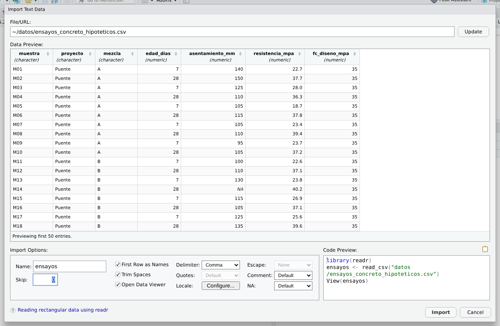

Los datos de un laboratorio de materiales casi nunca llegan como un vector suelto. Llegan como un cuadro: cada fila es un cilindro ensayado y cada columna dice algo de él, como el proyecto, el tipo de mezcla, la edad del ensayo y la resistencia obtenida. En R, ese cuadro se llama data frame. Este capítulo enseña a crear un data frame, a leerlo desde un archivo CSV o Excel, a revisarlo y a transformarlo para responder preguntas concretas, como cuál es la resistencia promedio de cada proyecto o cuántos cilindros cumplen la especificación. Primero se hace todo con las funciones básicas de R y después con el paquete dplyr, que hace lo mismo con instrucciones más fáciles de leer.

## Qué es un data frame {#sec-datos-dataframe}

Un data frame es un conjunto de vectores del mismo largo, puestos lado a lado como columnas. Cada columna es una variable y puede tener su propio tipo (numérico, texto, lógico), pero dentro de una columna todos los valores son del mismo tipo. Cada fila es una observación: un cilindro, una hora de conteo, una muestra de suelo.

Un data frame pequeño se crea con la función `data.frame()`, dando el nombre y los valores de cada columna:

```{r}
cilindros <- data.frame(
  muestra = c("M01", "M02", "M03", "M04"),
  mezcla = c("A", "A", "B", "B"),
  edad_dias = c(7, 28, 7, 28),
  resistencia_mpa = c(22.7, 37.7, 24.1, 39.6)
)
cilindros
```

Cuando los datos de un análisis están organizados así, con una variable por columna, una observación por fila y un valor por celda, se dice que están ordenados [@wickham2017r4ds]. Es la forma que esperan casi todas las funciones de R, y conviene usarla desde que se registran los datos en el laboratorio o en el campo.

## Leer datos desde un archivo {#sec-datos-leer}

En la práctica los datos vienen en un archivo. Los dos formatos más comunes son CSV (*comma-separated values*, valores separados por comas), que es un archivo de texto que cualquier programa abre, y Excel. En este capítulo se usa un conjunto de 60 ensayos de compresión de cilindros de concreto de tres proyectos. Los datos son hipotéticos y se pueden descargar con el botón siguiente.

```{r}
#| echo: false
source("R/ver_datos.R")
ver_datos("datos/ensayos_concreto_hipoteticos.csv",
          nombres = c("Muestra", "Proyecto", "Mezcla", "Edad (días)",
                      "Asentamiento (mm)", "Resistencia (MPa)", "Resistencia de diseño (MPa)"))
```

Para que los ejemplos funcionen, el archivo se guarda en la subcarpeta `datos/` del proyecto de RStudio (@sec-r-proyectos).

### Archivos CSV

Con las funciones básicas de R, un CSV se lee con `read.csv()`. El resultado se guarda en un objeto:

```{r}
ensayos <- read.csv("datos/ensayos_concreto_hipoteticos.csv")
```

El paquete readr, del tidyverse, tiene la función `read_csv()` (con guion bajo), que es más rápida con archivos grandes y avisa qué tipo le asignó a cada columna:

```{r}
library(readr)
ensayos_tbl <- read_csv("datos/ensayos_concreto_hipoteticos.csv")
```

Las dos dan el mismo contenido. `read_csv()` devuelve un *tibble*, que es un data frame con una forma de imprimirse en la consola más compacta. En este libro se usan las dos.

RStudio también tiene un asistente para importar datos sin escribir código: File > Import Dataset > From Text (readr) (@fig-datos-importar). El asistente muestra una vista previa y, abajo a la derecha, el código que va a ejecutar. Conviene copiar ese código al script para que la lectura quede registrada.

{#fig-datos-importar fig-alt="Diálogo Import Text Data de RStudio con la vista previa de los datos y el código de importación" width="85%"}

::: {.callout-warning title="Cuidado"}
En los computadores configurados en español, Excel a veces guarda los CSV con punto y coma (`;`) como separador y coma como separador decimal. Si al leer el archivo aparece una sola columna con todo el texto junto, se usa `read.csv2()` o `read_csv2()`, que esperan ese formato.
:::

### Archivos de Excel

Los archivos `.xlsx` se leen con el paquete readxl. Con el argumento `sheet` se elige la hoja:

```{r}
library(readxl)
ensayos_xl <- read_excel("datos/ensayos_concreto_hipoteticos.xlsx", sheet = 1)
```

```{r}
#| echo: false
ver_datos("datos/ensayos_concreto_hipoteticos.xlsx", tabla = FALSE)
```

## Revisar un data frame {#sec-datos-revisar}

Antes de calcular nada, conviene revisar que los datos se leyeron bien. Estas funciones se usan siempre al empezar:

```{r}
dim(ensayos)       # filas y columnas
names(ensayos)     # nombres de las columnas
head(ensayos, 3)   # primeras 3 filas
```

La función `str()` (de *structure*) muestra el tipo de cada columna y sus primeros valores. Es la forma más rápida de detectar una columna numérica que se leyó como texto:

```{r}
str(ensayos)
```

`summary()` da un resumen de cada columna: mínimo, cuartiles, media y máximo para las numéricas, y el número de datos faltantes (`NA's`):

```{r}
summary(ensayos[, c("asentamiento_mm", "resistencia_mpa")])
```

La columna de asentamiento tiene dos datos faltantes. Para ver el data frame completo como una hoja de cálculo se usa `View(ensayos)`, con V mayúscula, que lo abre en una pestaña del editor (@fig-datos-view). En esa vista se puede ordenar por una columna haciendo clic en su encabezado y filtrar con el botón Filter, sin cambiar los datos.

{#fig-datos-view fig-alt="Pestaña del editor de RStudio que muestra el data frame de ensayos como una hoja de cálculo con encabezados ordenables" width="85%"}

## Seleccionar y transformar con R base {#sec-datos-base}

### Columnas

Una columna se toma con el signo `$` seguido de su nombre. El resultado es un vector, y con él se usa todo lo del capítulo anterior:

```{r}
mean(ensayos$resistencia_mpa)
table(ensayos$proyecto)
```

### Filas y columnas con corchetes

Un data frame tiene dos dimensiones, así que entre corchetes se escriben dos posiciones separadas por una coma: primero las filas y después las columnas, `datos[filas, columnas]`. Si una de las dos se deja vacía, R toma todas.

```{r}
ensayos[1:3, ]                                   # filas 1 a 3, todas las columnas
ensayos[1:3, c("muestra", "resistencia_mpa")]    # filas 1 a 3, dos columnas
```

En vez de posiciones se puede escribir una condición. R conserva las filas donde la condición es `TRUE`:

```{r}
puente_28 <- ensayos[ensayos$proyecto == "Puente" & ensayos$edad_dias == 28, ]
nrow(puente_28)
```

### Columnas nuevas y orden

Una columna nueva se crea asignándole un valor con `$`. Por ejemplo, la razón entre la resistencia obtenida y la de diseño, y si el cilindro cumple:

```{r}
ensayos$razon <- ensayos$resistencia_mpa / ensayos$fc_diseno_mpa
ensayos$cumple <- ensayos$resistencia_mpa >= ensayos$fc_diseno_mpa
head(ensayos[, c("muestra", "edad_dias", "razon", "cumple")], 4)
```

Para ordenar las filas se usa `order()` dentro de los corchetes. El signo menos ordena de mayor a menor:

```{r}
head(ensayos[order(-ensayos$resistencia_mpa), c("muestra", "proyecto", "resistencia_mpa")], 3)
```

### Resumir por grupos

La función `aggregate()` calcula un resumen para cada grupo. La fórmula `resistencia_mpa ~ proyecto + edad_dias` se lee "resistencia según proyecto y edad":

```{r}
aggregate(resistencia_mpa ~ proyecto + edad_dias, data = ensayos, FUN = mean)
```

## El operador pipe {#sec-datos-pipe}

Antes de presentar dplyr hace falta un operador nuevo, el pipe, que se escribe `%>%`. Su trabajo es pasar el resultado de una instrucción a la siguiente. Se lee "y luego".

Sin el pipe, varias operaciones seguidas se escriben unas dentro de otras, y se leen de adentro hacia afuera:

```{r}
round(mean(ensayos$resistencia_mpa), 1)
```

Con el pipe, la misma cuenta se escribe en el orden en que se hace: se toma la resistencia, y luego se calcula el promedio, y luego se redondea a un decimal.

```{r}
library(dplyr)    # dplyr trae el pipe %>%

ensayos$resistencia_mpa %>%
  mean() %>%
  round(1)
```

La regla es una sola: lo que está a la izquierda de `%>%` entra como primer argumento de la función de la derecha. Así, `x %>% mean()` es lo mismo que `mean(x)`, y `x %>% round(1)` es lo mismo que `round(x, 1)`. El atajo para escribirlo en RStudio es Ctrl + Shift + M.

::: {.callout-tip title="En la práctica"}
Una receta de cocina se escribe en orden: picar la cebolla, luego sofreírla, luego agregar el arroz. Nadie la escribe como "agregar el arroz a sofreír picar la cebolla". El pipe deja escribir el código como una receta, un paso por línea.
:::

## Transformar con dplyr {#sec-datos-dplyr}

El paquete dplyr tiene un puñado de funciones, llamadas verbos, que hacen las operaciones más comunes con un data frame [@wickham2017r4ds]. Todas reciben el data frame como primer argumento, así que se encadenan con el pipe. El @tbl-datos-verbos los resume junto con su equivalente en R base.

```{r}
#| label: tbl-datos-verbos
#| tbl-cap: "Verbos de dplyr y su equivalente en R base."
#| echo: false

library(kableExtra)
data.frame(
  verbo = c("filter()", "select()", "mutate()", "arrange()", "summarise()", "group_by()", "count()"),
  hace = c("Elige filas que cumplen una condición", "Elige columnas",
           "Crea o cambia columnas", "Ordena filas", "Resume en un valor",
           "Agrupa para resumir por grupo", "Cuenta filas por grupo"),
  base = c("datos[condición, ]", "datos[, c(\"a\", \"b\")]", "datos$nueva <- ...",
           "datos[order(...), ]", "mean(datos$x)", "aggregate()", "table()")
) %>%
  kbl(col.names = c("Verbo", "Qué hace", "Equivalente en R base"), align = "lll") %>%
  kable_styling(full_width = FALSE, bootstrap_options = c("hover", "condensed"))
```

Dentro de los verbos, las columnas se escriben sin el nombre del data frame y sin `$`:

```{r}
# Elegir filas: cilindros del puente ensayados a 28 días
ensayos %>%
  filter(proyecto == "Puente", edad_dias == 28) %>%
  select(muestra, mezcla, resistencia_mpa) %>%
  head(3)
```

```{r}
# Crear columnas y ordenar
ensayos %>%
  mutate(razon = resistencia_mpa / fc_diseno_mpa) %>%
  arrange(desc(razon)) %>%
  select(muestra, proyecto, razon) %>%
  head(3)
```

La combinación más útil es `group_by()` seguida de `summarise()`: primero se separan los datos por grupo y después se calcula el resumen de cada uno.

```{r}
ensayos %>%
  group_by(proyecto, edad_dias) %>%
  summarise(n = n(),
            media_mpa = mean(resistencia_mpa),
            .groups = "drop")
```

La función `n()` cuenta las filas de cada grupo. Para contar sin calcular nada más está `count()`:

```{r}
ensayos %>% count(proyecto, mezcla)
```

::: {.callout-note title="Ejemplo: resistencia a 28 días del edificio"}

**Planteamiento.** Con los datos de ensayos (hipotéticos), calcule para el proyecto Edificio la resistencia promedio a 28 días, la de cada tipo de mezcla y la proporción de cilindros que alcanzan la resistencia de diseño de 28 MPa.

**Solución:**

1. Se eligen las filas del edificio ensayadas a 28 días. Son 10 cilindros: los de la mezcla A dieron 27.6, 30.9, 30.1, 28.3 y 31.3 MPa, y los de la mezcla B, 32.3, 31.1, 33.4, 33.2 y 32.8 MPa.
2. Promedio general: la suma es 311.0 MPa, así que $\bar{x} = 311.0 / 10 = 31.10$ MPa.
3. Promedio por mezcla: mezcla A, $148.2 / 5 = 29.64$ MPa; mezcla B, $162.8 / 5 = 32.56$ MPa.
4. Cumplimiento: solo el cilindro de 27.6 MPa queda por debajo de 28 MPa, así que cumplen 9 de 10, una proporción de 0.90.

**Pseudocódigo**

1. Leer el archivo de ensayos.
2. Filtrar el proyecto Edificio y la edad de 28 días.
3. Calcular el promedio y la proporción de cilindros que cumplen.
4. Repetir el cálculo agrupando por mezcla.

```{r}
# 1) Datos
ensayos <- read.csv("datos/ensayos_concreto_hipoteticos.csv")

# 2) y 3) Con R base
edif <- ensayos[ensayos$proyecto == "Edificio" & ensayos$edad_dias == 28, ]
mean(edif$resistencia_mpa)
mean(edif$resistencia_mpa >= edif$fc_diseno_mpa)
aggregate(resistencia_mpa ~ mezcla, data = edif, FUN = mean)

# 2) a 4) Con dplyr
library(dplyr)
ensayos %>%
  filter(proyecto == "Edificio", edad_dias == 28) %>%
  group_by(mezcla) %>%
  summarise(media_mpa = mean(resistencia_mpa),
            prop_cumple = mean(resistencia_mpa >= fc_diseno_mpa))
```

**Interpretación.** Las dos formas dan los mismos números que el cálculo a mano. La mezcla B rinde casi 3 MPa más que la A, y el único cilindro que no alcanzó la resistencia de diseño es de la mezcla A. Si el edificio sigue con la mezcla A, convendría revisar su dosificación; la Parte V explica cómo decidir si una diferencia así es real o puede deberse al azar.

:::

## Guardar resultados {#sec-datos-guardar}

Un resultado se guarda en un archivo CSV con `write.csv()`. El argumento `row.names = FALSE` evita que R agregue una columna con el número de fila:

```{r}
#| eval: false
resumen <- ensayos %>%
  group_by(proyecto, edad_dias) %>%
  summarise(media_mpa = mean(resistencia_mpa), .groups = "drop")

write.csv(resumen, "resumen_resistencias.csv", row.names = FALSE)
```

El archivo queda en la carpeta del proyecto y se puede abrir con Excel.

## Ejercicios propuestos

Use los datos de conteo vehicular por hora de una intersección (hipotéticos) para los ejercicios 1 a 4.

```{r}
#| echo: false
ver_datos("datos/transito_horario_hipotetico.csv",
          nombres = c("Hora", "Tipo de día", "Vehículos"))
```

1. Lea el archivo `transito_horario_hipotetico.csv` y revíselo con `str()` y `summary()`. ¿Cuántas filas y columnas tiene? ¿De qué tipo es cada columna?
2. Con R base, calcule el total de vehículos de un día laboral y de un día de fin de semana.
3. Con dplyr, encuentre la hora de mayor tránsito de cada tipo de día. Pista: use `group_by()` y `filter(vehiculos == max(vehiculos))`.
4. Cree una columna `periodo` que valga `"punta"` cuando hay más de 800 vehículos y `"valle"` en otro caso (use `ifelse()`). Cuente cuántas horas de cada periodo hay por tipo de día.
5. Con los datos de ensayos, calcule el asentamiento promedio de cada proyecto. ¿Qué pasa si no usa `na.rm = TRUE`?
6. Con los datos de ensayos, calcule la razón entre la resistencia a 7 días y la de diseño para cada proyecto. ¿Qué fracción de la resistencia de diseño se alcanza, en promedio, a los 7 días?
7. Escriba en R base y con dplyr la instrucción que da los cinco cilindros de menor resistencia a 28 días, con su proyecto y su mezcla.

## Lecturas recomendadas

- @wickham2017r4ds, capítulos 5 y 11: los verbos de dplyr y la lectura de archivos con readr, con muchos ejemplos.
- @long2019cookbook, capítulos 4 y 6: recetas para leer, escribir y transformar data frames con R base y con el tidyverse.
