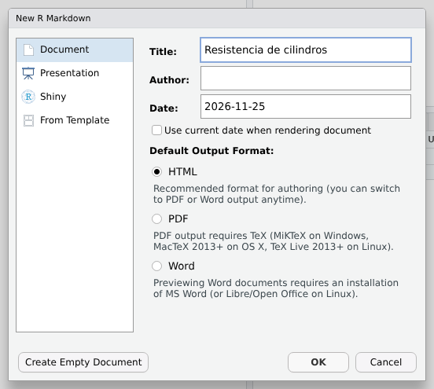
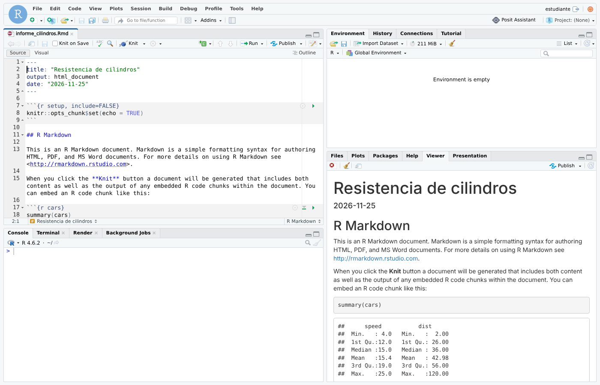

::: {.quote-block}
"Cambiemos nuestra actitud tradicional ante la construcción de programas: en lugar de imaginar que nuestra tarea principal es indicarle a una computadora qué hacer, concentrémonos en explicarles a seres humanos qué queremos que haga la computadora."\
— *Donald E. Knuth [-@knuth1984literate, p. 97]. Traducción propia.*
:::

Un informe de laboratorio hecho de la forma tradicional tiene tres piezas separadas: una hoja de cálculo con los datos, un programa o una calculadora para los resultados y un procesador de texto donde se copian los números y se pegan los gráficos. Si aparece un dato corregido, hay que repetir los cálculos, volver a copiar cada número y volver a pegar cada gráfico, y es fácil que alguno quede desactualizado. R Markdown junta las tres piezas en un solo archivo: el texto, el código y los resultados viven juntos, y el documento se vuelve a generar completo con un clic. A esa propiedad se le llama reproducibilidad: cualquier persona con el archivo y los datos obtiene el mismo informe. Este capítulo explica cómo se arma un documento de R Markdown, cómo se compila a HTML y cómo se incluyen cuadros, ecuaciones y resultados dentro del texto [@xie2018rmarkdown].

## Qué es un documento de R Markdown {#sec-rmd-que-es}

Un archivo de R Markdown tiene extensión `.Rmd` y es un archivo de texto con tres tipos de contenido:

- Encabezado: unas pocas líneas entre dos filas de tres guiones (`---`) con el título, el autor, la fecha y el formato de salida. Se escribe en un formato llamado YAML.
- Texto: los párrafos del informe, escritos en Markdown, que es una forma sencilla de dar formato con símbolos (por ejemplo, un `#` al inicio de una línea indica un título).
- Bloques de código: trozos de R entre tres acentos graves (```` ``` ````). Al compilar el documento, R ejecuta cada bloque y coloca el resultado, sea un número, un cuadro o un gráfico, justo debajo del código.

La @fig-rmd-partes muestra un archivo mínimo con las tres partes.

::: {#fig-rmd-partes}

````markdown
---
title: "Ensayo de cilindros"
author: "Laboratorio de Materiales"
output: html_document
---

## Resultados

La resistencia media del lote es la siguiente:

```{{r}}
resistencia <- c(27.4, 29.1, 26.8, 30.2, 28.5)
mean(resistencia)
```
````

Archivo mínimo de R Markdown: encabezado, texto y un bloque de código.

:::

El proceso que convierte ese archivo en un documento terminado se llama compilación, y en RStudio se hace con el botón Knit ("tejer"), porque el resultado entreteje el texto con el código y sus resultados. Al presionarlo, RStudio hace dos cosas seguidas: primero ejecuta el código de cada bloque y luego arma el documento final con el texto y los resultados. Todo lo necesario viene con RStudio y con el paquete rmarkdown; no hay que instalar nada más.

## Crear y compilar un documento {#sec-rmd-crear}

### Paso 1: instalar el paquete rmarkdown

La primera vez se instala el paquete, como cualquier otro (@sec-r-paquetes):

```{r}
#| eval: false
install.packages("rmarkdown")
```

Si se olvida este paso, RStudio muestra un aviso amarillo en la parte de arriba del editor al abrir el primer archivo `.Rmd`, con un botón para instalarlo.

### Paso 2: crear el archivo

Se usa el menú File > New File > R Markdown. Se abre la ventana de la @fig-rmd-nuevo, donde se escribe el título y el autor y se elige HTML como formato de salida. Al presionar OK, RStudio crea un archivo de ejemplo que ya tiene las tres partes; conviene compilarlo una vez tal como está para comprobar que todo funciona y luego borrar el contenido de ejemplo y escribir el propio.

{#fig-rmd-nuevo fig-alt="Ventana New R Markdown de RStudio con los campos Title y Author y la opción HTML seleccionada como formato de salida" width="85%"}

### Paso 3: guardar y compilar

Antes de compilar se guarda el archivo (Ctrl + S) dentro de la carpeta del proyecto, junto a la carpeta de datos. Luego se presiona el botón Knit de la barra del editor, o el atajo Ctrl + Shift + K. RStudio ejecuta todos los bloques en orden, genera un archivo `.html` con el mismo nombre en la misma carpeta y lo muestra en una ventana aparte o en el panel Viewer, según la configuración (@fig-rmd-knit).

{#fig-rmd-knit fig-alt="RStudio con el archivo informe_cilindros.Rmd abierto en el editor, el botón Knit en la barra del editor y, en el panel Viewer de la derecha, el documento HTML compilado" width="85%"}

::: {.callout-warning title="Cuidado"}
Al compilar, R empieza desde cero, en una sesión vacía: no ve los objetos que se crearon en la consola. Si un bloque usa un objeto o un paquete que solo se cargó en la consola, la compilación se detiene con un error como `object 'ensayos' not found`. Todo lo que el documento necesita, incluidos `library()` y la lectura de los datos, tiene que estar escrito en sus propios bloques. Esa exigencia es justamente lo que garantiza que el informe se pueda reproducir.
:::

Mientras se escribe no hace falta compilar todo el documento cada vez. Cada bloque tiene a la derecha un botón con un triángulo verde que lo ejecuta en la consola, y Ctrl + Enter ejecuta la línea donde está el cursor, igual que en un script.

## Texto con Markdown {#sec-rmd-markdown}

Markdown usa unos pocos símbolos para dar formato. El @tbl-rmd-markdown resume los que se usan en un informe técnico.

```{r}
#| label: tbl-rmd-markdown
#| tbl-cap: "Formato básico de Markdown."
#| echo: false
library(kableExtra)
data.frame(
  Escritura = c("`# Título`", "`## Subtítulo`", "`*cursiva*`", "`**negrita**`",
                "`- elemento`", "`1. elemento`", "`` `codigo` ``",
                "`[texto](https://ejemplo.org)`", "``",
                "Línea en blanco"),
  Resultado = c("Título de primer nivel", "Título de segundo nivel", "*cursiva*",
                "**negrita**", "Elemento de una lista con viñetas",
                "Elemento de una lista numerada", "`codigo` en letra de máquina",
                "Enlace a una página", "Imagen con su pie", "Separa dos párrafos")
) %>%
  kbl(escape = FALSE) %>%
  kable_styling(full_width = FALSE, bootstrap_options = c("hover", "condensed"))
```

Dos detalles causan la mayoría de los problemas al empezar. El primero es que un párrafo nuevo necesita una línea en blanco antes; un simple salto de línea se une al párrafo anterior. El segundo es que las listas y los títulos también necesitan una línea en blanco antes, o no se reconocen.

En el interactivo de la @fig-rmd-interactivo se puede probar la sintaxis: lo que se escribe en el recuadro de la izquierda aparece con formato a la derecha. Reconoce los títulos, la cursiva, la negrita, el código y las listas del @tbl-rmd-markdown.

::: {#fig-rmd-interactivo}

```{=html}
<div class="interactivo" id="int-markdown">
  <div style="display:flex; flex-wrap:wrap; gap:1rem;">
    <textarea aria-label="Texto en Markdown" spellcheck="false"
      style="flex:1 1 260px; min-height:230px; font-family:monospace; font-size:0.9rem; padding:0.5rem; border:1px solid currentColor; border-radius:4px; background:transparent; color:inherit;">## Ensayo de cilindros

Se ensayaron **cinco** cilindros a 28 días.
La resistencia de diseño es *28 MPa*.

Datos en `ensayos.csv`:

- Mezcla A
- Mezcla B

1. Leer los datos.
2. Calcular la media.</textarea>
    <div class="vista" aria-live="polite" style="flex:1 1 260px; min-height:230px; padding:0.25rem 0.75rem; border:1px dashed currentColor; border-radius:4px;"></div>
  </div>
</div>
<script>
(function () {
  var raiz = document.getElementById("int-markdown");
  var entrada = raiz.querySelector("textarea"), vista = raiz.querySelector(".vista");
  function escapar(t) { return t.replace(/&/g, "&amp;").replace(/</g, "&lt;").replace(/>/g, "&gt;"); }
  function enLinea(t) {
    return escapar(t)
      .replace(/`([^`]+)`/g, "<code>$1</code>")
      .replace(/\*\*([^*]+)\*\*/g, "<strong>$1</strong>")
      .replace(/\*([^*]+)\*/g, "<em>$1</em>");
  }
  function convertir(texto) {
    var bloques = texto.replace(/\r/g, "").split(/\n\s*\n/), html = "";
    bloques.forEach(function (b) {
      var lineas = b.split("\n").filter(function (l) { return l.trim() !== ""; });
      if (!lineas.length) return;
      var m = lineas[0].match(/^(#{1,4})\s+(.*)$/);
      if (m && lineas.length === 1) {
        var n = m[1].length + 2;
        html += "<h" + n + ">" + enLinea(m[2]) + "</h" + n + ">";
      } else if (lineas.every(function (l) { return /^\s*[-*]\s+/.test(l); })) {
        html += "<ul>" + lineas.map(function (l) { return "<li>" + enLinea(l.replace(/^\s*[-*]\s+/, "")) + "</li>"; }).join("") + "</ul>";
      } else if (lineas.every(function (l) { return /^\s*\d+\.\s+/.test(l); })) {
        html += "<ol>" + lineas.map(function (l) { return "<li>" + enLinea(l.replace(/^\s*\d+\.\s+/, "")) + "</li>"; }).join("") + "</ol>";
      } else {
        html += "<p>" + enLinea(lineas.join(" ")) + "</p>";
      }
    });
    return html;
  }
  function actualizar() { vista.innerHTML = convertir(entrada.value); }
  entrada.addEventListener("input", actualizar);
  actualizar();
})();
</script>
```

Vista previa de Markdown: el texto de la izquierda se muestra con formato a la derecha.

:::

## Bloques de código y sus opciones {#sec-rmd-bloques}

Un bloque de código se inserta con el menú Code > Insert Chunk o con el atajo Ctrl + Alt + I. Dentro de las llaves, después de la `r`, se pueden escribir opciones separadas por comas que controlan qué se muestra en el documento final:

````markdown
```{{r, echo = FALSE, fig.cap = "Resistencia por proyecto."}}
boxplot(resistencia_mpa ~ proyecto, data = ensayos)
```
````

El @tbl-rmd-opciones reúne las opciones más usadas.

```{r}
#| label: tbl-rmd-opciones
#| tbl-cap: "Opciones frecuentes de los bloques de código."
#| echo: false
data.frame(
  Opcion = c("`echo = FALSE`", "`eval = FALSE`", "`include = FALSE`",
             "`message = FALSE`", "`warning = FALSE`",
             "`fig.cap = \"...\"`", "`fig.width = 6, fig.height = 4`"),
  Efecto = c("Ejecuta el código y muestra el resultado, pero oculta el código",
             "Muestra el código sin ejecutarlo",
             "Ejecuta el código sin mostrar ni el código ni el resultado",
             "Oculta los mensajes, como los que aparecen al cargar un paquete",
             "Oculta las advertencias",
             "Agrega un pie al gráfico",
             "Fija el ancho y el alto del gráfico, en pulgadas")
) %>%
  kbl(col.names = c("Opción", "Efecto"), escape = FALSE) %>%
  kable_styling(full_width = FALSE, bootstrap_options = c("hover", "condensed"))
```

En un informe dirigido a alguien que no programa, lo usual es ocultar el código con `echo = FALSE` y dejar solo los resultados. En una tarea o en un documento de trabajo, en cambio, conviene mostrarlo para que se pueda revisar cómo se obtuvo cada número. El primer bloque de un documento suele ser uno con `include = FALSE` que carga los paquetes y lee los datos.

## Resultados dentro del texto {#sec-rmd-en-linea}

Un número también se puede calcular dentro de un párrafo. Se escribe un acento grave, la letra `r`, un espacio, la instrucción y otro acento grave:

```markdown
La resistencia media del lote fue de `r knitr::inline_expr("round(mean(r28), 1)")` MPa.
```

Al compilar, R reemplaza esa expresión por su valor, y el lector ve "La resistencia media del lote fue de 31.1 MPa". Si se corrige un dato y se vuelve a compilar, el número del texto cambia solo. Así se evita el error más común de los informes copiados a mano: un texto que dice una cifra y un cuadro que dice otra.

## Cuadros y ecuaciones {#sec-rmd-cuadros}

### Cuadros con kable

Un data frame impreso en la consola tiene un aspecto poco presentable. La función `kable()` del paquete knitr lo convierte en un cuadro con formato; el argumento `digits` fija los decimales y `col.names` cambia los encabezados. El paquete kableExtra, que se usa en este libro, agrega estilos con `kable_styling()`.

```{r}
library(knitr)
ensayos <- read.csv("datos/ensayos_concreto_hipoteticos.csv")
e28 <- ensayos[ensayos$edad_dias == 28, ]
resumen <- aggregate(resistencia_mpa ~ proyecto, data = e28, FUN = mean)
kable(resumen, digits = 2, col.names = c("Proyecto", "Resistencia media (MPa)"))
```

### Ecuaciones

Las ecuaciones se escriben con la notación de LaTeX, que es el estándar para escribir matemáticas en computadora. Entre signos de dólar sencillos, `$...$`, la ecuación queda dentro del párrafo; entre signos dobles, `$$...$$`, queda centrada en su propia línea. Por ejemplo, la media de $n$ datos se escribe así:

```markdown
$$\bar{x} = \frac{1}{n} \sum_{i=1}^{n} x_i$$
```

y se ve así:

$$
\bar{x} = \frac{1}{n} \sum_{i=1}^{n} x_i
$$

El @tbl-rmd-latex muestra las piezas de LaTeX que aparecen con más frecuencia en este libro.

```{r}
#| label: tbl-rmd-latex
#| tbl-cap: "Notación de LaTeX de uso frecuente."
#| echo: false
data.frame(
  Escritura = c("`x_i`", "`x^2`", "`\\frac{a}{b}`", "`\\sqrt{x}`", "`\\bar{x}`",
                "`\\sum_{i=1}^{n}`", "`\\mu, \\sigma, \\alpha`", "`\\leq, \\geq, \\neq`"),
  Resultado = c("$x_i$", "$x^2$", "$\\frac{a}{b}$", "$\\sqrt{x}$", "$\\bar{x}$",
                "$\\sum_{i=1}^{n}$", "$\\mu, \\sigma, \\alpha$", "$\\leq, \\geq, \\neq$")
) %>%
  kbl(escape = FALSE) %>%
  kable_styling(full_width = FALSE, bootstrap_options = c("hover", "condensed"))
```

::: {.callout-note title="Ejemplo: informe del lote del edificio a 28 días"}

**Planteamiento.** Con los ensayos a 28 días del proyecto Edificio (datos hipotéticos), prepare un informe en R Markdown que muestre la resistencia media, el número de cilindros que cumplen la resistencia de diseño de 28 MPa y un cuadro por mezcla. Los números del texto deben salir del código, no escribirse a mano.

**Solución:**

Antes de escribir el documento se hacen los cálculos a mano, para saber qué debe mostrar el informe.

1. Las diez resistencias son 27.6, 30.9, 30.1, 28.3 y 31.3 MPa (mezcla A) y 32.3, 31.1, 33.4, 33.2 y 32.8 MPa (mezcla B).
2. La suma es 311.0 MPa y la media es $\bar{x} = 311.0 / 10 = 31.10$ MPa.
3. Solo el cilindro de 27.6 MPa está por debajo de 28 MPa, así que cumplen 9 de 10.
4. Por mezcla, la media de A es $148.2 / 5 = 29.64$ MPa y la de B es $162.8 / 5 = 32.56$ MPa.

**Pseudocódigo**

1. Escribir el encabezado con título, autor y formato HTML.
2. En un bloque oculto, cargar knitr, leer los datos y filtrar el edificio a 28 días.
3. Escribir el párrafo de resultados con la media y el número de cilindros que cumplen calculados en línea.
4. Agregar un bloque con el cuadro de medias por mezcla y su pie.
5. Compilar con Knit y comparar los números con los del cálculo a mano.

El archivo completo es el siguiente:

````markdown
---
title: "Resistencia del concreto del edificio a 28 días"
author: "Laboratorio de Materiales"
output: html_document
---

```{{r, include = FALSE}}
library(knitr)
ensayos <- read.csv("datos/ensayos_concreto_hipoteticos.csv")
edif <- ensayos[ensayos$proyecto == "Edificio" & ensayos$edad_dias == 28, ]
```

## Resultados

Se ensayaron `r knitr::inline_expr("nrow(edif)")` cilindros a 28 días. La resistencia
media fue de `r knitr::inline_expr("round(mean(edif$resistencia_mpa), 2)")` MPa y
`r knitr::inline_expr("sum(edif$resistencia_mpa >= 28)")` cilindros alcanzaron la
resistencia de diseño de 28 MPa.

```{{r, echo = FALSE}}
por_mezcla <- aggregate(resistencia_mpa ~ mezcla, data = edif, FUN = mean)
kable(por_mezcla, digits = 2, col.names = c("Mezcla", "Media (MPa)"),
      caption = "Resistencia media por mezcla.")
```
````

Al compilarlo, el párrafo y el cuadro se ven así:

```{r}
#| echo: false
edif <- ensayos[ensayos$proyecto == "Edificio" & ensayos$edad_dias == 28, ]
```

> Se ensayaron `r nrow(edif)` cilindros a 28 días. La resistencia media fue de `r round(mean(edif$resistencia_mpa), 2)` MPa y `r sum(edif$resistencia_mpa >= 28)` cilindros alcanzaron la resistencia de diseño de 28 MPa.

```{r}
#| echo: false
por_mezcla <- aggregate(resistencia_mpa ~ mezcla, data = edif, FUN = mean)
kable(por_mezcla, digits = 2, col.names = c("Mezcla", "Media (MPa)"))
```

**Interpretación.** Los números del documento coinciden con el cálculo a mano: 10 cilindros, media de 31.1 MPa (R no escribe el cero final), 9 que cumplen y medias de 29.64 y 32.56 MPa por mezcla. Si mañana se corrige el resultado del cilindro M22, basta con cambiar el archivo de datos y presionar Knit para que el texto y el cuadro se actualicen a la vez.

:::

## Quarto {#sec-rmd-quarto}

Quarto es el sucesor de R Markdown, desarrollado por la misma empresa que hace RStudio. Usa la misma idea, texto en Markdown con bloques de código, pero en archivos con extensión `.qmd`, y funciona igual con R, Python y otros lenguajes. Este libro está escrito con Quarto. Para quien ya sabe R Markdown, el cambio es pequeño:

- Se crea con File > New File > Quarto Document y se compila con el botón Render en lugar de Knit.
- En el encabezado, el formato se escribe `format: html` en lugar de `output: html_document`.
- Las opciones de un bloque se escriben, de preferencia, dentro del bloque en líneas que empiezan con `#|`, por ejemplo `#| echo: false`.

````markdown
```{{r}}
#| echo: false
#| fig-cap: "Resistencia por proyecto."
boxplot(resistencia_mpa ~ proyecto, data = ensayos)
```
````

Casi todo lo que se escribe en un archivo `.Rmd` funciona sin cambios en un `.qmd`. Para las tareas y los informes de este libro sirve cualquiera de los dos; R Markdown tiene la ventaja de que hay más ejemplos y ayuda en internet, y Quarto, la de ser el formato que se seguirá desarrollando.

::: {.callout-tip title="En la práctica"}
Un buen hábito es crear un proyecto de RStudio por cada informe o tarea (@sec-r-proyectos), con una carpeta `datos` para los archivos de entrada y el `.Rmd` en la carpeta principal. Así la ruta `datos/archivo.csv` funciona en cualquier computadora, y para entregar el trabajo basta con comprimir la carpeta del proyecto.
:::

## Ejercicios propuestos

1. Cree un documento de R Markdown nuevo, compílelo sin cambios y localice en la carpeta el archivo HTML que se generó.
2. Escriba un documento con un título, dos subtítulos, una lista numerada de tres pasos y una palabra en negrita. Compílelo y compruebe que cada elemento se ve como espera.
3. Agregue un bloque que lea los datos de ensayos y dibuje un histograma de la resistencia. Compile el documento una vez con `echo = TRUE` y otra con `echo = FALSE`, y compare los resultados.
4. Escriba un párrafo que diga cuántos cilindros del puente se ensayaron a 28 días y cuál fue su resistencia media, con los números calculados en línea.
5. Haga un cuadro con `kable()` que muestre, para cada proyecto, la resistencia media a 7 días y a 28 días, con un decimal.
6. Escriba en LaTeX la fórmula del área de un círculo, $A = \pi D^2 / 4$, primero dentro de un párrafo y luego centrada en su propia línea.
7. Borre a propósito la línea que lee los datos del documento del ejemplo y compílelo. Lea el mensaje de error y explique por qué el documento no se compila aunque el objeto exista en la consola.

## Lecturas recomendadas

- @xie2018rmarkdown, capítulos 2 y 3: la guía de referencia de R Markdown, escrita por el autor de knitr.
- @wickham2017r4ds, capítulo sobre R Markdown: una introducción breve con el flujo de trabajo de un análisis completo.
- @knuth1984literate: el artículo que propuso escribir programas pensando primero en el lector humano, idea de la que parten R Markdown y Quarto.
