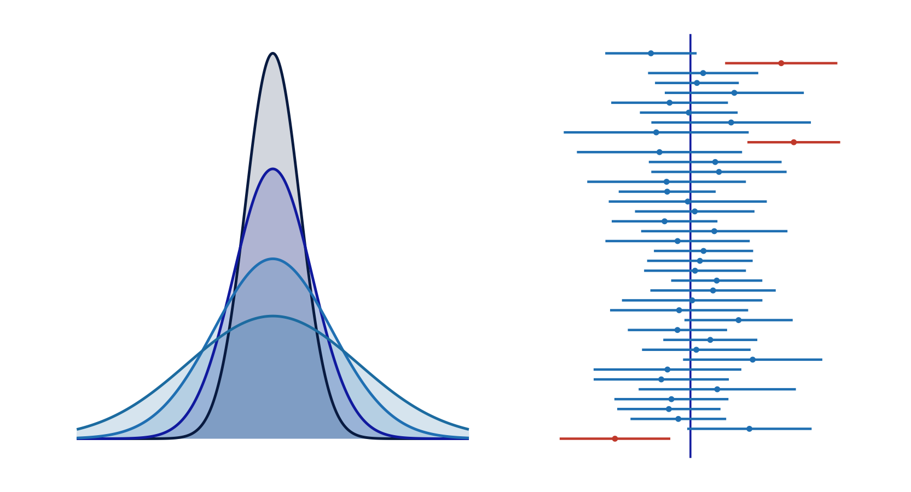

# Estadística Aplicada a la Ingeniería {.unnumbered .portada-titulo-oculto}

::: {.portada}

Escuela de Ingeniería Civil · Universidad de Costa Rica

Estadística Aplicada a la Ingeniería

Fundamentos, métodos y aplicaciones con R

Ing. Edwin Matarrita Segura, M.Sc.

<!-- Imagen provisional de producción propia (herramientas/figura_portada.R).
     Se cambia cuando el autor elija la imagen definitiva. -->
<figure class="portada-imagen">

</figure>

Cómo citar

Matarrita Segura, E. (2026). <i>Estadística aplicada a la ingeniería: fundamentos, métodos y aplicaciones con R</i>. Escuela de Ingeniería Civil, Universidad de Costa Rica.

Licencia

 Texto bajo <a href="https://creativecommons.org/licenses/by-nc-sa/4.0/deed.es">CC BY-NC-SA 4.0</a>. Código R bajo licencia <a href="https://github.com/ems270900/Libro_Estad-stica/blob/main/LICENSE-CODE">MIT</a>, de uso libre.

:::
